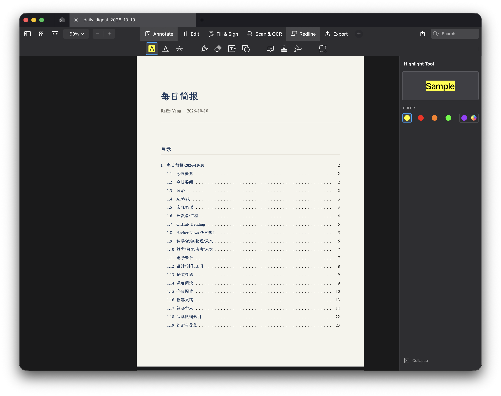

# PDF Expert Patcher
A patcher that makes PDF Expert feel more at home on macOS.

- Left close tabs
- Hide AI & Translator
- Hide sidebar close button



---

当前版本见 [VERSION](VERSION)：**1.4.0**。面向 macOS 官网 DMG 版 PDF Expert 的
四个独立运行时补丁；已知适配基线为 **3.13.4 build 1177**。

| 模块 | 效果 |
|---|---|
| TabPatch | 标签关闭按钮移到左侧 |
| SidebarPatch | 隐藏已识别的编辑工具右侧栏关闭按钮 |
| ToolbarPatch | 隐藏 AI 与翻译工具栏入口 |
| KeychainFix | 沿用已恢复正常的登录钥匙串路由 |

大版本失效或其他 LLM 接手：先读 [AGENTS.md](AGENTS.md)，再读
[交接手册](docs/handoff.md)。完整文档见 [文档索引](docs/index.md)。

## 日常使用

需要 Xcode 或 Command Line Tools、Python 3。Hopper 仅重新逆向时需要。
在项目目录运行：

```bash
./patch.sh                              # 官方更新覆盖安装后，全量构建并安装
./patch.sh --check                      # 只读检查加载命令、签名、架构、版本和哈希
./patch.sh --build SidebarPatch         # 只构建一个模块；省略名字则构建四个
./patch.sh --update SidebarPatch        # 只构建/更新已注入的一个模块
./patch.sh --test                       # 全部自动测试和临时 app 部署演练
./patch.sh --status-json                # 机器可读身份报告，不包含完整签名检查
./patch.sh --record-compatibility       # 采集观察，人工验收字段保持 pending
./patch.sh --restore                    # 恢复匹配版本/构建的完整官方 app
```

模块名可选 `TabPatch`、`SidebarPatch`、`ToolbarPatch`、`KeychainFix`。
`--update` 不修改或重签主程序，不更新其他模块；目标尚未注入或路径不匹配时，
需使用全量安装。应用更新通常会抹掉注入，所以**官方覆盖更新后运行 `./patch.sh`**，
而不是单模块更新。若内部实现变化，需按交接手册适配，不能保证只重跑就兼容。

构建和测试不更改实际 app、已安装 dylib 或用户钥匙串；测试只操作临时替身 app。
安装/更新会正常退出 PDF Expert，尊重未保存文档提示，不强制结束进程。
确认退出后再执行部署；没有进程查询权限时停止，不把查询失败当作已退出。

## 版本识别

默认构建产物在 `build/`；安装文件在 `~/Library/PEPatch/`。每个新 dylib 都配套
`NAME.json`，记录项目版本、模块源码/构建配方/二进制哈希。安装记录还关联 app 版本。

`--check` 分别显示安装版本、真实 SHA256、与当前构建/源码/配方是否匹配。
JSON 观察还记录主程序 SHA256、实际 app 路径及各架构的补丁引用路径；这些是静态证据，人工验收仍需单独完成。
旧模块没有元数据会显示 `unknown (untracked)`，这不代表模块失效，也不猜测版本。
元数据与二进制不匹配则报告错误；源码或构建不同只表明有差异，不证明兼容性有问题。
重签可能改变字节，因此构建哈希和安装哈希分别保留。技术细节见
[架构说明](docs/architecture.md)。

## 备份与恢复

全量安装在副本完成注入、签名和验证后提交；进程内失败会尝试回滚。
只重签外层 bundle，不深度重签嵌套代码。单模块更新同时提交该 dylib 和元数据，
更新前在 `backup/updates/NAME/<时间>-<哈希>/` 保留旧模块及恢复记录。

完整官方快照保存在 `backup/<版本>-<构建号>-<哈希>/`；恢复检查版本/构建、SHA256、
Readdle Team ID 和完整签名。备份不会自动清理。旧 `PDF Expert.orig.*` 只有主程序，
不能恢复整个 bundle 的官方签名；模块更新备份也不等于完整官方 app。

如果已有完整官方副本，可先保存：

```bash
PDF_EXPERT_APP="/path/to/official/PDF Expert.app" ./patch.sh --backup-original
./patch.sh --restore
```

缺少完整快照时，使用官方安装包恢复应用后再安装补丁。不要拼接主程序或删除签名来
冒充官方原版。全量安装会拒绝完整签名校验失败的 app；单模块更新不修复已有签名问题。

app、外部 dylib 和元数据不是一个原子事务，断电/SIGKILL 不保证自动回滚。
回滚本身失败时保留错误指出的 `.pepatch-*` 目录。权限不足时停止，不自动调用 sudo；
先检查目标父目录、安装目录和备份目录权限，避免把全部产物都变成 root 所有。

## 已确认的登录基线

v1.3.1 收窄 KeychainFix 查询范围后出现重启需登录的回归；v1.3.2 已撤回，用户确认正常。
v1.4.0 **保留统一查询路由，只改善诊断日志**，不再用 service/class/DP/group 同时匹配
限制读写。详细证据见 [兼容性记录](docs/compatibility.md)。

ad-hoc 签名会改变应用身份，可能影响钥匙串、iCloud、扩展等。自动测试不能代替
真实界面、保存文档和登录后重启验收；arm64 构建通过也不等于 arm64 运行验证。

## 调试与配置

直接 exec 主程序时设置环境变量；`open -a` 不传递这些变量：

| 变量 | 用途 |
|---|---|
| `TABPATCH_DEBUG=1` | 标签约束日志 |
| `SIDEBARPATCH_DEBUG=1` / `TOOLBARPATCH_DEBUG=1` | 按钮 identifier 诊断 |
| `KEYCHAINFIX_DEBUG=1` | 操作、状态码/错误说明、class/字段存在性；不输出账号或字段值 |
| `SIDEBARPATCH_DISABLE=1` / `TOOLBARPATCH_DISABLE=1` | 停用对应界面修改，保留原方法调用 |
| `KEYCHAINFIX_DISABLE=1` | 启动时跳过 fishhook 安装，不删除或迁移已有凭据 |

开关按变量是否存在判断，包括值为 `0` 的情况；取消设置才会关闭开关。
日志默认不输出每次钥匙串调用；启动时仍保留补丁安装结果日志。

| 配置变量 | 默认值 |
|---|---|
| `PDF_EXPERT_APP` | `/Applications/PDF Expert.app` |
| `PEPATCH_BUILD_DIR` | 项目 `build/` |
| `PEPATCH_BACKUP_DIR` | 项目 `backup/` |
| `PEPATCH_INSTALL_DIR` | `~/Library/PEPatch` |

可用 `DEVELOPER_DIR`、`CLANG`、`SDKROOT`、`PYTHON` 覆盖工具路径。
注入使用绝对 dylib 路径；迁移安装目录后需全量重装补丁，长路径可能耗尽 header 空间。
fishhook 来源及许可证见 [vendor 说明](src/vendor/README.md)。
